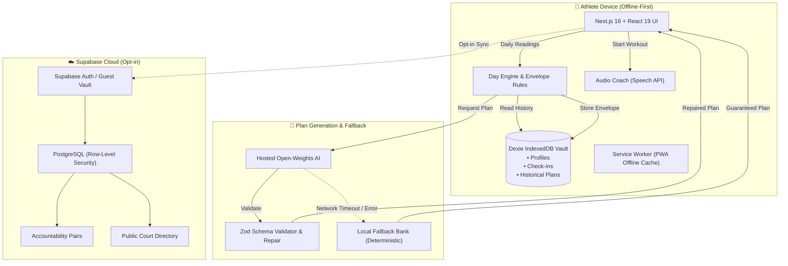

<div align="center">

  

  # Bahar

  ### The Failure-Tolerant Athletic Training Engine

  [](https://nextjs.org/)
  [](https://react.dev/)
  [](https://www.typescriptlang.org/)
  [](https://tailwindcss.com/)
  [](https://dexie.org/)
  [](https://supabase.com/)
  [](https://vitest.dev/)
  [](https://playwright.dev/)
  [](LICENSE)

  <p align="center">
    <strong>Expect failure. Embrace the wall. Own the court.</strong><br />
    Bahar (/bəˈhɑːr/ — <em>Renewal, Springtime, Unstoppable Momentum</em>) is an athletic training companion engineered from sports-science first principles. Designed to function in zero-cellular dead zones, forgive missed sessions without guilt, and protect joints through dynamic daily capacity envelopes.
  </p>

  <p align="center">
    <a href="#-key-features">Key Features</a> •
    <a href="#-system-architecture">Architecture</a> •
    <a href="#-quick-start">Quick Start</a> •
    <a href="#-progressive-web-app-pwa">Install PWA</a> •
    <a href="#-data-sovereignty--privacy">Data Privacy</a> •
    <a href="#-contributing">Contributing</a>
  </p>

</div>

---

## ⚡ Why Bahar?

Most fitness applications are built around **brittle, shame-inducing mechanics**:
- Rigid 7-day calendars that penalize you in red when life gets in the way.
- Cloud lock-in requiring active 5G signals on remote outdoor courts.
- Opaque algorithms that push heavy sets when your tendons are already inflamed.

**Bahar flips this paradigm completely:**
1. **Failure-Tolerant by Design**: If you miss a session, your training envelope automatically adapts. No broken streak counters, no guilt banners.
2. **The 4:00 AM Boundary**: Human training days don't reset at midnight. Late night sessions belong to the day you started them.
3. **100% Offline Sovereignty**: Your athlete profile, baseline tests, and completed workouts live inside your device's IndexedDB vault. Zero cloud accounts required.
4. **Hands-Free Court Guidance**: Native browser audio coach speaks interval cues through your earbuds while your phone stays safely parked against the court bench.

---

## 🚀 Key Features

| Feature | Description | Status |
| :--- | :--- | :---: |
| **🏸 Daily Envelope Engine** | Evaluates sleep, physical energy, and localized soreness to calculate your exact minutes and intensity ceiling for today. | ✅ Active |
| **🛡️ Instant Plan B Throttling** | Low energy or rain? 1-click toggles your prescribed session into gentle shadow footwork or mobility recovery. | ✅ Active |
| **🔊 Hands-Free Voice Coach** | Browser Speech Synthesis announces drills, counts down interval rests, and delivers court technique advice. | ✅ Active |
| **📱 Universal PWA Download** | Installable in 1 click on Android, Chrome, Edge, and iOS Safari ("Add to Home Screen"). Works without WiFi. | ✅ Active |
| **📍 Court & Wall Directory** | Community-verified outdoor courts, sheltered hitting walls, and lighting notes with distance & surface filters. | ✅ Active |
| **👥 Accountability Pairs** | Pair with a training partner. Exchange high-fives and mutual progress with strict Supabase Row-Level Security. | ✅ Active |
| **📊 Screen vs. Court Volume** | High-contrast visual analytics mapping your active weekly court minutes directly against sedentary device time. | ✅ Active |
| **🔒 Data Vault & Self-Wipe** | One-tap JSON export of your complete training database. Instant local wipe with zero trace left behind. | ✅ Active |
| **🌓 Dual Theme Engine** | High-contrast court Dark mode & daylight-optimized Light mode with zero layout shift. | ✅ Active |

---

## 🏛️ System Architecture



For comprehensive technical documentation, schemas, and design invariants, see [**`ARCHITECTURE.md`**](ARCHITECTURE.md).

---

## 🛠️ Tech Stack

- **Framework**: [Next.js 16 (App Router)](https://nextjs.org/) with React 19 & Turbopack
- **Language**: [TypeScript 5](https://www.typescriptlang.org/) (Strict type-checking)
- **Styling**: [Tailwind CSS 4](https://tailwindcss.com/)
- **Local Database**: [Dexie.js](https://dexie.org/) (IndexedDB wrapper with transactional queries)
- **Backend / Sync**: [Supabase](https://supabase.com/) (PostgreSQL with Row-Level Security)
- **Validation**: [Zod](https://zod.dev/)
- **Unit Testing**: [Vitest 5](https://vitest.dev/)
- **End-to-End Testing**: [Playwright](https://playwright.dev/)
- **Icons**: Custom SVG & [Lucide React](https://lucide.dev/)

---

## ⚡ Quick Start

### 1. Clone & Install
```bash
# Clone the repository
git clone https://github.com/learnerabhinavdwivedi-droid/wingigs.git
cd wingigs/bahar

# Install dependencies (respects modern peer dependency standards)
npm install
```

### 2. Environment Setup (Optional)
Bahar runs **100% offline out-of-the-box** without any cloud configuration. To connect Supabase for cloud sync or an open-weight AI model:
```bash
cp .env.example .env.local
```

#### Running with a Real Open-Weight AI Model (Ollama / vLLM / Hugging Face)
Bahar communicates with any OpenAI-compatible open-weight endpoint. You can run Gemma 2 2B or LLaMA 3.2 100% locally on your machine:
```bash
# Pull and serve an open-weight model with Ollama
ollama pull gemma2:2b
ollama serve
```

Then in `.env.local`:
```env
AI_BASE_URL=http://localhost:11434/v1
AI_MODEL=gemma2:2b
AI_API_KEY=
```

*Note: If `AI_BASE_URL` is omitted, Bahar automatically activates its deterministic sports-science fallback plan bank. The app never crashes or returns fake canned text.*

#### Live Weather Shaping
Bahar connects directly to [Open-Meteo](https://open-meteo.com/) (open-access, zero-API-key weather & air quality APIs) to adapt your envelope to real-time precipitation, temperature, and AQI. If offline, safe local defaults protect your workout.

### 3. Launch Development Server
```bash
npm run dev
```
Open [**http://localhost:3000**](http://localhost:3000) in your browser.

---

## 🧪 Testing & Verification

Bahar is backed by strict unit and end-to-end testing pipelines:

```bash
# Run TypeScript compilation check
npm run typecheck

# Run unit tests with Vitest (Domain rules, RLS, Day key boundaries)
npm run test:unit

# Run full end-to-end integration tests with Playwright
npm run test:e2e

# Run production build compilation
npm run build
```

---

## 📱 Progressive Web App (PWA)

Bahar is built to install natively on any smartphone, tablet, or desktop:

- **Desktop Chrome / Edge**: Click the **Download App** button in the top navigation bar or the browser address bar install icon.
- **Android**: Tap the in-app **"Download App"** button for a 1-tap home screen install.
- **iPhone & iPad (iOS Safari)**:
  1. Open the URL in Safari.
  2. Tap the **Share** button (`⎋`).
  3. Tap **"Add to Home Screen"** (`⊞`).
  4. Launch Bahar with full-screen native styling and offline storage.

---

## 🛡️ Data Sovereignty & Privacy

We treat athletic biometric and training records with zero-compromise security:
- **Zero Cloud by Default**: All check-in readings, training minutes, and injury flags stay strictly in your device's browser vault.
- **No Third-Party Analytics Trackers**: We do not inject invasive advertising or behavioral surveillance SDKs.
- **Full Portability**: Export your complete database anytime via `Settings -> Export JSON`.
- **Immediate Right-to-Wipe**: Tap `Self-Wipe Data` in settings to permanently purge all local records from IndexedDB in milliseconds.

---

## 🤝 Contributing

We welcome community contributions, court additions, and sports-science improvements! Please check out [**`CONTRIBUTING.md`**](CONTRIBUTING.md) for local setup instructions, code style standards, and the pull request checklist.

---

## 📄 License

Bahar is open-source software licensed under the [**MIT License**](LICENSE).

<div align="center">
  <sub>Built with relentless focus by athletes, for athletes.</sub>
</div>
